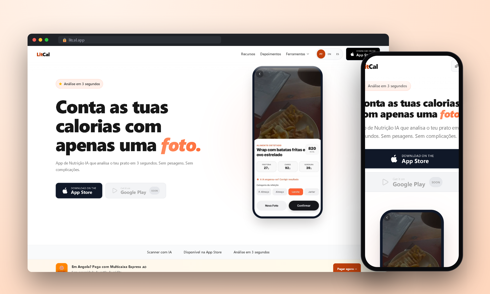
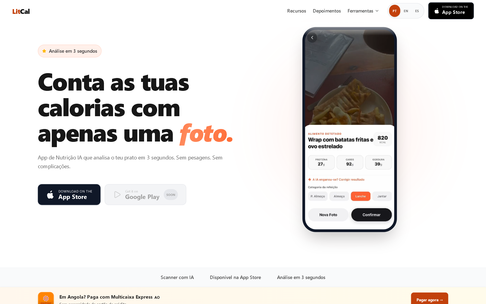
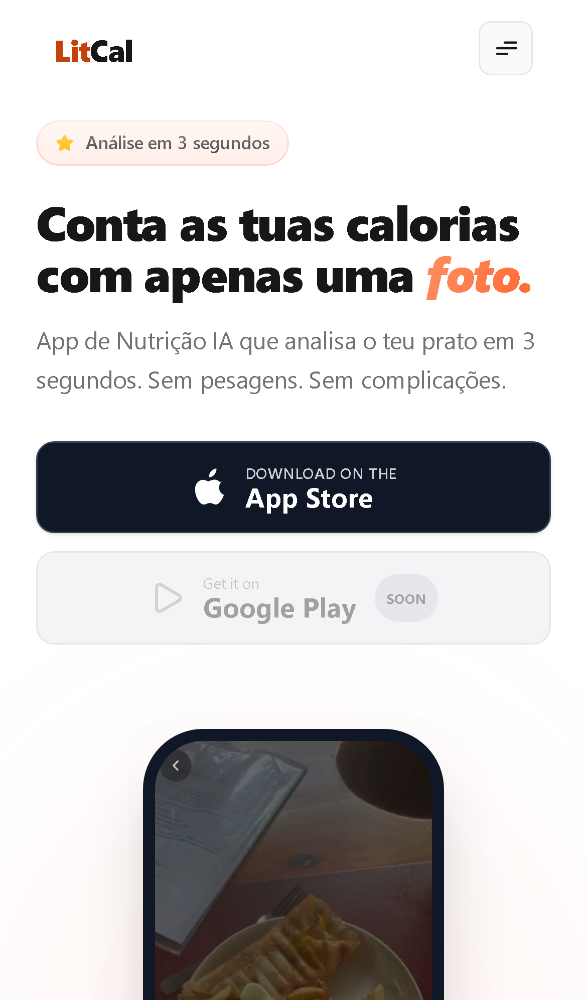

# LitCal

AI nutrition app for iOS, live on the App Store. Take a photo of a meal and get calories and macros in seconds.

 

## Highlights

- **Photo to macros:** meal analysis from a single photo with GPT-4 Vision.
- **Shipped fast:** from first commit to App Store release in 2 weeks.
- **Monetized:** subscriptions with RevenueCat and Multicaixa Express.
- **Traction:** 600+ downloads and 1,000+ USD revenue in the first month, with no paid ads.

## Screenshots

| Desktop | Mobile |
|---|---|
|  |  |

## Stack

     

## My role

Full-stack development: requirements, UI, front-end, back-end, deploy and support in production.

## Source code

The source code is private because it belongs to the client. I am happy to walk through the architecture and the code in an interview.

---

Built by **[Erick Rodrigues](https://github.com/Erickrodrigues05)**, Full-Stack Developer · erickrodrigues781@gmail.com
